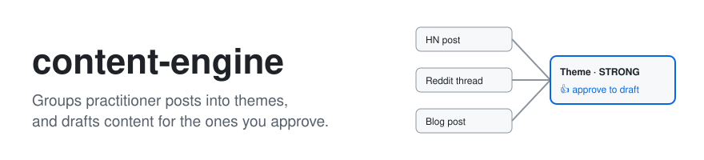

<picture>
  <source media="(prefers-color-scheme: dark)" srcset=".github/assets/banner-dark.svg">
  
</picture>

<a href=".github/assets/demo.gif"></a>

Many sources → evidence-backed themes → your approval → reviewed writing. [View animated demo](.github/assets/demo.gif) · [Demo notes](.github/assets/demo/README.md).


[](LICENSE)

[CI workflow](https://github.com/tetriz-ai/content-engine/actions/workflows/ci.yml)

Content Engine brings your configured community, news, publishing-platform and competitor sources into one signal bank, groups them into evidence-graded themes, and turns the themes and formats you approve into reviewed writing. It runs in Claude Code or Codex and bundles the Blog and Editorial Draft workflows.

## Contents

- [What it does](#what-it-does) says what a run does and which helper scripts come with it.
- [Quick start](#quick-start) takes a fresh clone to a dry run and then to your first approval card.
- [Choosing an entry point](#choosing-an-entry-point) matches what you have to the entry point that uses it.
- [Usage](#usage) shows each entry point in one complete example.
- [Reference](#reference) holds the exact rules for each entry point, with its steps, sources, files, flags and settings.
- [Limitations](#limitations) lists what the tool does not do for you.
- [Project](#project) covers versioning, tests, contributing and the license.

## What it does

- **`/content-engine`** saves each new post from your sources, called a signal, to a file called the signal bank and groups the posts into themes graded STRONG or THIN. On the next run it drafts a blog post, a LinkedIn post or a video brief for each format you approve on the theme's Slack card or in its theme doc. The grouping and the grade are the model's judgement, and no code checks them ([Reference](#content-engine)).
- **The helper scripts** run single steps without the daily command: reporting, drafting one theme, scoring, fetching posts, and saving your own posts as voice examples. [Choosing an entry point](#choosing-an-entry-point) matches each one to what you have.

Nothing is ever published. Each draft is a Markdown file in `docs/content-themes/drafts/` that you review and post yourself.

## Standalone writing pipeline and imports

**Editorial Draft ← Blog ← Content Engine.** This repository owns all three layers;
each lower layer accepts caller inputs without depending on the planning engine.
There is no dependency on a product-workflow repository. Reviewed facts, source
scope, voice, public-use permissions and output paths come from the caller.

- [Content Engine](SKILL.md) routes scans, clustering, approval, inventory,
  competitor gaps, refresh plans, weekly queues and multi-format writing.
- [Blog](skills/blog/SKILL.md) owns the complete article workflow: intent research,
  claim ledger, approved outline, sourced drafting/revision, editorial review,
  SEO/GEO checks when extensions exist, and the publishing package.
- [Editorial Draft](skills/editorial-draft/SKILL.md) owns writing presets, eight editorial
  reviewer contracts, AI-pattern scrub and final polish. It also runs directly for
  requested refinement. Known voice and approvals skip repeated setup.

To use the pipeline in either host, link the native skills into your working repository:

```sh
python3 /absolute/path/to/content-engine/scripts/install-skills.py --into /absolute/path/to/your-repo
```

In Claude Code, invoke `/content-engine` or `/blog` through the installed skill catalog.
The writing skill is now named `editorial-draft`. Re-run the installer to add its
canonical host links. Existing `articleforge` links remain usable through the legacy
`skills/articleforge` compatibility symlink; the installer leaves local copies and
custom edits untouched. New integrations should use `editorial-draft`. The context
resolver retains its deprecated `articleforge` key as an alias to the same entrypoint.

In Codex, ask it to use the installed `content-engine`, `blog` or `editorial-draft` skill
with your approved inputs. The root `commands/` and `.claude-plugin/plugin.json`
also expose Claude plugin commands without a second copy of the editorial pipeline.
For a weekly review, use Content Engine's [weekly guide](references/weekly.md); it
stops at a review packet and queue. [Planning](references/planning.md) covers
inventory, competitor-gaps and refresh-plan as well as evidence/format eligibility.

Engine code, rules and templates are read from the installed checkout. Configuration,
credentials, archives, signal bank, themes and drafts belong to your working repository.
The skill resolves these paths explicitly; imports never scan, write or configure
accounts. Config paths are caller-root-relative, or explicit absolute authorized
paths. `--config` overrides the default `packages/content-engine/config.yaml` in the
caller repository. Do not write state into an imported checkout. The standalone
clone continues to use the existing layout because engine and working roots coincide.

SEO skills/providers are optional extensions supplied by the host. Their upstream
origins and licenses are documented in [third-party notices](THIRD-PARTY-NOTICES.md). Missing providers
leave metrics unmeasured; missing extension procedures permit labeled qualitative
checks, not claims that formal audits ran. Blog and LinkedIn do not silently fall
back to a one-prompt writer. Review personas are labeled as same-session work unless
separate agents really execute. Nothing is published automatically.

The machine-readable [pipeline manifest](pipeline-manifest.json) lists entrypoints,
writing routes and required resources for importing applications. Consumers record
an exact revision and own refresh policy; upstream changes are not fetched during
ordinary skill execution. Upgrades never migrate your config or drafts into the engine.

## Quick start

You need macOS or Linux, Claude Code or Codex, Python 3.9 or newer, and git. Slack and external providers are optional.

CI tests the scripts, not a run in either host. [Works with](#works-with) says what has been run.

The default writing pipeline runs in the host session and needs no separate API key beyond your host access: blog articles use Blog followed by Editorial Draft; LinkedIn posts use Editorial Draft directly; video output remains a brief. An explicitly configured custom writer remains supported. Existing configs with `write.blog.command: packages/content-engine/write_reference.py` keep that explicit reference route; remove that key in a reviewed config change to adopt the full default pipeline. `write_reference.py` is an opt-in one-prompt/API implementation, not the full editorial pipeline; its no-key response-file path remains available.

### 1. Clone the repo and install PyYAML in a virtual environment

```sh
git clone https://github.com/tetriz-ai/content-engine.git
cd content-engine
python3 -m venv .venv
. .venv/bin/activate
pip install -r packages/scanner-core/requirements.txt
```

Keep the virtual environment active when you start either host, so the command's scripts find PyYAML. Without one, a run never installs into the system Python: it stops and asks you to activate `.venv`.

### 2. Preview a run

Choose your host, keeping the virtual environment active and the working directory
at the repo root.

For Claude Code, start `claude`, then type:

```text
/content-engine --dry-run
```

For Codex, register the native skills in this checkout, then start the host:

```sh
python3 scripts/install-skills.py --into .
codex
```

In the Codex session, ask:

```text
Use the installed content-engine skill with --dry-run.
```

Later `/content-engine` examples use Claude Code notation. In Codex, ask the
installed `content-engine` skill to run with the same mode and arguments.

For a noninteractive Claude Code preview, use the command in
[Run it every day](#run-it-every-day) with `/content-engine --dry-run` in place
of `/content-engine`.

With no config yet, the preview uses the bundled example keywords, asks no questions, installs nothing and writes only under `working/`. It reads Hacker News and the first 2 example subreddits, sends nothing to Slack, and takes a few minutes because of Reddit's pacing ([Reference](#content-engine)).

The bundled keywords are about flaky CI tests, for a made-up product, so the preview may group a few live posts into a theme or find none. Its summary says how many posts each source returned, that it ran on the bundled examples, and which preview files it wrote under `working/`, such as `working/preview-scan-<date>.json`.

To see a finished draft file before you configure anything, see [Draft one theme by hand](#draft-one-theme-by-hand).

### 3. Connect Slack (optional)

To get approval cards in Slack, connect the Slack connector in Claude Code (type `/mcp` to check it is there) and create the setup file:

```sh
cp packages/content-engine/.env.example packages/content-engine/.env
```

Set `CONTENT_ENGINE_SLACK_CHANNEL` in that file to where the cards go. A member ID, which starts with `U`, sends every card to you as a direct message. A channel ID, which starts with `C` or `G`, posts the cards in that channel.

To copy your member ID, open your Slack profile, click ⋮, then Copy member ID.

### 4. Run it for real

In Claude Code, run:

```text
/content-engine
```

In Codex, ask:

```text
Use the installed content-engine skill for a normal run without --dry-run.
```

If you skipped step 3, this run creates `.env` from the template and stops before asking anything. Fill in the Slack member ID, or leave it empty to go without Slack, and run `/content-engine` again.

With `.env` in place, the first run asks eight short questions, two of them optional, and writes your config from the answers. They cover what you build, who it is for, your competitors, the words your users use and the subreddits they post in. The last three ask which voice to write in, where you already publish, and whether to add Google Trends or Semrush.

### 5. Approve a theme, then run `/content-engine` again

In Slack, react 👍 on a theme's card to approve it, or ✏️ and reply in the card's thread with what to change. Without Slack, open the theme's doc in `docs/content-themes/` and change its lines to `**Status:** approved` and, for example, `**Formats approved:** [blog]`. The next run writes the drafts you approved.

A theme doc looks like [`packages/content-engine/examples/theme-example-ci-flakiness.md`](packages/content-engine/examples/theme-example-ci-flakiness.md), and [`packages/content-engine/examples/draft-example-ci-flakiness-blog.md`](packages/content-engine/examples/draft-example-ci-flakiness-blog.md) is a hand-written example draft, both for a made-up product.

Before you publish one, check each claim against the theme doc's signals. Editorial review does not guarantee factual accuracy.

## Choosing an entry point

| You have | Use | Example |
|---|---|---|
| A fresh clone, and you want to preview a whole run, approvals and drafts included | `/content-engine --dry-run` | [Preview a run](#preview-a-run) |
| A fresh clone, and you want only the scan and grouping on the bundled examples | `/content-engine --mode quickstart` | [Preview a run](#preview-a-run) |
| Your own keywords, with or without Slack | `/content-engine` | [Run it every day](#run-it-every-day) |
| A few runs behind you, with their signal bank and theme docs | `report.py` | [See which sources pay off](#see-which-sources-pay-off) |
| An approved theme doc | `write_reference.py` | [Draft one theme by hand](#draft-one-theme-by-hand) |
| Your own editorial pipeline | `write.<format>.command` | [Plug in a writer of your own](#plug-in-a-writer-of-your-own) |
| Posts of your own on Substack, Medium, LinkedIn or a blog | `archive_fetch.py` | [Save your own posts as voice examples](#save-your-own-posts-as-voice-examples) |
| A saved archive of your posts | `archive_tag.py` | [Tag your posts by type](#tag-your-posts-by-type) |
| A writer profile, a YAML file of your topics and archive settings like `packages/content-engine/writer-profile.example.yaml` | `relevance_scorer.py` | [Score a theme against your writer profile](#score-a-theme-against-your-writer-profile) |
| Competitor blogs with a feed | `competitor-blog-scan.py` | [Read competitor blog feeds](#read-competitor-blog-feeds) |
| Keywords, and no Claude Code | `scanner_core.py` | [Use the fetchers on their own](#use-the-fetchers-on-their-own) |

Every entry point keeps its state in plain files in your working repository. Only `/content-engine` posts to Slack.

## Usage

The [command file](.claude/commands/content-engine.md) documents every mode and step, and the [examples folder](examples/README.md) holds complete examples included in the CI workflow. [docs/walkthrough.md](docs/walkthrough.md) follows one theme from its signals to a draft, and [docs/glossary.md](docs/glossary.md) defines the terms. [docs/demo-transcript.md](docs/demo-transcript.md) is a trimmed dry run of an earlier command, without the source plan.

### Preview a run

When: before your first real run, or after changing your config.

Run `/content-engine --dry-run` as in [Quick start step 2](#2-preview-a-run). Read the summary it ends with. It names every file it wrote and every source that failed.

To preview only the scan and grouping, always on the bundled examples, type this instead:

```text
/content-engine --mode quickstart
```

### Run it every day

When: you want new themes each day and drafts for the ones you approved.

```text
/content-engine
```

To run it on a schedule, do the first run by hand. Then schedule the commands below from your working repository, for example with cron. Replace `<Slack tools>` with your Slack connector's tool names, and add your Semrush MCP tools if you use Semrush.

Type `/mcp` in Claude Code to see the names. A scheduled run cannot approve tool calls, so a tool left out fails silently. Read each run's summary in `working/content-engine.log`.

```sh
engine_root="$(pwd -P)" # standalone checkout; for an import, use its absolute engine directory
. .venv/bin/activate && claude -p "/content-engine" --allowedTools "Read Write(./working/**) Write(./context-library/**) Write(./docs/content-themes/**) Edit(./working/**) Edit(./context-library/**) Edit(./docs/content-themes/**) Glob Grep WebSearch WebFetch Bash(python3 -c \"import yaml\") Bash(python3 -c \"import sys; print(sys.prefix != sys.base_prefix)\") Bash(python3 $engine_root/packages/scanner-core/scanner_core.py:*) Bash(python3 $engine_root/packages/content-engine/competitor-blog-scan.py:*) Bash(python3 $engine_root/packages/content-engine/report.py:*) Bash(python3 $engine_root/packages/content-engine/write_reference.py:*) Bash(python3 $engine_root/packages/content-engine/relevance_scorer.py:*) Bash(python3 $engine_root/packages/content-engine/archive_fetch.py:*) Bash(python3 $engine_root/packages/content-engine/archive_tag.py:*) Bash(python3 $engine_root/scripts/resolve-context.py:*) <Slack tools>" >> working/content-engine.log 2>&1
```

For an importing application, set `engine_root` to the installed Content Engine
checkout and keep the working directory at the caller. Activate a caller-accessible virtual environment.
The allow list uses that engine's absolute script paths; it does not permit arbitrary
Python commands. `WebFetch` supports publication-date verification for approved sources.
Keep Slack tools absent when delivery has not been authorized. Complete setup manually first.
The Write/Edit permissions cover the default output paths only; if your caller config
uses different bank, archive or theme paths, replace them with those exact directories.
Never grant writes to the whole caller checkout.

Reddit scanning uses a 240-second budget by default, including pacing, retries,
worker startup, DNS, connection setup and response reads. Each request runs in a
short-lived worker that is stopped and joined at the deadline. Feeds above 8 MiB
are rejected with a failure record.
Completed feeds survive a timeout; every unfinished feed is listed in `failures`,
so a partial scan is never presented as complete. Review those failures before
using a quiet day as evidence of low activity. See [scanner settings](packages/scanner-core/README.md).

Remember:

- After each run, commit `context-library/content-signal-bank.jsonl`, `docs/content-themes/` and `context-library/content-themes-log.md`.
- A source that fails is reported in the summary and skipped. It never stops the run.

### See which sources pay off

When: you want to know which configured sources ever produce a theme.

```sh
python3 packages/content-engine/report.py \
  --bank packages/content-engine/examples/content-signal-bank.example.jsonl \
  --themes-dir packages/content-engine/examples
```

```text
=== Signal bank ===
Total rows: 3 (3 un-spent, 0 spent)

By source — spent / total (the real tuning signal: a source
that's always near 0% is scanning noise, not evidence):
  competitor_blog       0 /    1     0%
  hn                    0 /    1     0%
  reddit                0 /    1     0%

=== Themes ===
Total: 1

By status:
  approved     1

By coverage tier:
  STRONG       1
```

On your own data, after your first `/content-engine` run has written `config.yaml`, run `python3 packages/content-engine/report.py --config packages/content-engine/config.yaml`.

Remember:

- A path that does not exist is named in a `[warn]` line, so a wrong path does not look like an empty bank.
- A source that stays near 0% never feeds a theme, so tune its keywords or drop it. A THIN theme can wait for more posts, or go out as a hedged blog post.

### Draft one theme by hand

When: you want a draft of one approved theme outside the daily run, or to see its prompt.

```sh
examples/draft-without-an-api-key/run.sh
```

```text
Draft written -> working/examples/draft-without-an-api-key.md
---
status: draft
format: blog
source_theme_doc: "packages/content-engine/examples/theme-example-ci-flakiness.md"
generated_at: <time>
drafted_by: "agent-session"
---

# Flaky tests cost more than the re-run

One Show HN post this month described a small CI plugin that re-runs a failed test once and
tags it flaky if the second run passes. Its authors say false-red builds fell by about a third
in the first month.

The same week, an engineer on r/ExperiencedDevs described a suite where about 15 tests fail
roughly one run in twenty, and a team that now re-runs every red build.

One named survey of 400 teams puts the median cost at 6.5 engineering hours a week. That is
one survey's median, not a rule for every team.

If your team also re-runs and moves on, start by counting how often it happens.
```

The [example](examples/draft-without-an-api-key/) passes `write_reference.py` a fixed sample answer with `--response-file`, so it shows the draft file, not the model's writing. The `generated_at` line shows your own time.

On your own theme, run `python3 packages/content-engine/write_reference.py --theme-doc docs/content-themes/<theme>.md --format blog --config packages/content-engine/config.yaml`. It calls the Anthropic API with `ANTHROPIC_API_KEY` from `.env` or the environment, and sends the whole theme doc.

To see the prompt instead:

```sh
python3 packages/content-engine/write_reference.py \
  --theme-doc packages/content-engine/examples/theme-example-ci-flakiness.md \
  --format video \
  --config packages/content-engine/config.example.yaml \
  --dry-run | sed -n '/^FORMAT SETTINGS/,/^- Pick/p'
```

```text
FORMAT SETTINGS (these override the format description above where they differ):
- Length: short (60-90 seconds).
- Key facts: 1-2 signal-cited facts.
- Pick the persona target from: practitioner, manager, executive.
```

Remember:

- Pass `--config`, or the `write` settings in your config do not apply.

### Plug in a writer of your own

When: you already have an editorial pipeline and want it to write the drafts.

```sh
examples/plug-in-your-own-writer/run.sh | head -n 1
```

```text
Outline written -> working/examples/outline.md
```

The [example](examples/plug-in-your-own-writer/) writer takes `--theme-doc`, `--format` and `--out`, and writes a Markdown draft with `status: draft` frontmatter. Point `write.<format>.command` in `config.yaml` at a program like it, and the run calls it in place of the bundled per-format workflow.

Remember:

- Your writer must refuse a theme with no signal itself. The bundled writer's refusal does not cover it.
- Your writer gets the theme doc, including the `## Author's take` and `## Requested changes` sections.

### Save your own posts as voice examples

When: you already publish on Substack, Medium, LinkedIn or a blog, and want drafts in your voice.

```sh
examples/save-a-whole-archive/run.sh | head -n 5
```

```text
  [warn] 2026-07-02-members-only-our-ci-bill-line-by-line.md is for paid subscribers, so only its preview was saved. Paste the full post into <tmp>/archive for a better voice example.
  <site> (archive): 3 posts, 3 new, 0 already saved
  [skip] 1 folder page(s) that list other pages
  <site>/sitemap.xml: 2 pages under /guides/
  <site>/sitemap.xml: 2 posts, 2 new, 0 already saved
```

This [example](examples/save-a-whole-archive/) serves a sample Substack archive and a sample blog sitemap on 127.0.0.1, so it runs offline. On your own posts, list them under `archive_sources` in your writer profile and run `python3 packages/content-engine/archive_fetch.py --profile <your writer profile>`.

| Source entry | What it saves |
|---|---|
| `substack: <name or domain>` | Every post in the publication's archive, each read whole |
| `medium_export: <zip or folder>` | Your published stories from Medium's "Download your information" export |
| `linkedin_export: <zip or folder>` | Your posts from LinkedIn's "Get a copy of your data" export |
| `sitemap: <URL>` with `path_prefix: /guides/` | Every page in that folder of the site, with its category from the URL folder |
| `medium: "@handle"` or `rss: <feed URL>` | The posts the feed carries, about 10 on Medium |

A post no source covers goes into `archive_dir` by hand, one `.md` or `.txt` file each. [`examples/read-your-exports`](examples/read-your-exports/) reads both exports, and [`examples/save-your-own-posts`](examples/save-your-own-posts/) reads a feed.

Remember:

- A post already saved is never fetched again. A long first run can stop and pick up where it left off on the next run.
- Point `write.voice_profile` in `config.yaml` at your writer profile, or the writer does not read the archive.

### Tag your posts by type

When: you have saved your posts and want each draft's examples to be posts of the same kind.

```sh
examples/tag-your-archive/run.sh
```

```text
  tag index: 4 post(s) added, from files with no entry
4 tagged, 0 untagged left -> <tmp>/archive/.tags.json
posts: 4, untagged: 0
categories: ci-reliability (3)
content types: checklist (1), personal story (1), postmortem (2)
voice examples: 2 of type "postmortem", 1 of category "ci-reliability"
```

The [example](examples/tag-your-archive/) applies a fixed sample answer with `--response-file`, so it shows the format, not the model's judgement. On your own archive, run `python3 packages/content-engine/archive_tag.py --profile <your writer profile>`, which calls the Anthropic API.

Remember:

- The types come from `content_types` in your writer profile. Edit the list to match what you write.
- Each post is tagged once. `--retag` marks them all to be tagged again. Give it on the first pass only, then repeat the tagging without it until nothing is left.

### Score a theme against your writer profile

When: you have a writer profile and want to check one candidate by hand.

```sh
python3 packages/content-engine/relevance_scorer.py \
  --profile packages/content-engine/writer-profile.example.yaml \
  --title "Flaky tests are a quiet tax on CI" \
  --rationale "Three posts this week on re-running red builds" \
  --response-file examples/score-a-theme-without-an-api-key/answer.txt
```

```text
{
  "score": 8,
  "fit": true,
  "why": "Flaky tests and CI re-runs are the core of the writer's CI reliability beat."
}
```

The answer file is a fixed sample, so this shows the output format, not the model's judgement. Without `--response-file`, the scorer calls the Anthropic API.

Remember:

- The score is the model's judgement of fit with your writer profile, not a measure of the theme's evidence.
- The daily run scores each new theme against your writer profile when `cluster.writer_profile` in `config.yaml` points at that file.

### Read competitor blog feeds

When: a competitor's blog has an RSS or Atom feed and you want its new posts as signals.

```sh
examples/read-a-competitor-feed/run.sh
```

```text
status: ok, 3 in the feed, 2 kept, 1 dropped with no date
2026-10-01T09:00:00+00:00  blog:example_blog:urn:example:1  Why we quarantine flaky tests
2026-09-30T08:00:00+00:00  blog:example_blog:urn:example:2  Measuring CI re-runs
```

The [example](examples/read-a-competitor-feed/) serves a sample feed on 127.0.0.1, so no request leaves the machine. On your own feeds, list them under `scan.competitor_blogs.feeds` and run `python3 packages/content-engine/competitor-blog-scan.py --config packages/content-engine/config.yaml`.

Remember:

- Check that a feed URL resolves and parses before you list it. Guessing a `/feed` path often finds nothing.

### Use the fetchers on their own

When: you want matching Hacker News, Reddit, Product Hunt or X posts as JSON, without Claude Code.

```sh
examples/find-posts-from-python/run.sh
```

```text
hn:101           Show HN: A flaky test detector for CI  [flaky test]
reddit:t3_aaa    Our CI pipeline reliability is getting worse  [ci pipeline reliability]
failed: reddit r/devops hot: HTTP Error 500: Internal Server Error
```

This [example](examples/find-posts-from-python/) calls `scan_hn` and `scan_reddit` from Python with canned replies, one of them a failed feed, so it runs offline. [scanner-core's README](packages/scanner-core/README.md) covers its output and Python functions. For Product Hunt, see [`examples/list-matching-product-hunt-launches`](examples/list-matching-product-hunt-launches/).

Remember:

- Read `failures` in the output as well as `candidates`. An empty `candidates` list with no failures means nothing matched.
- The block above is standard output. Progress lines go to standard error.

## Reference

### `/content-engine`

Each run takes these steps, in this order.

| Step | What happens |
|---|---|
| Setup check | If `.env` is missing, creates it from the template and stops. If PyYAML is missing, installs it into the active virtual environment, or stops and asks you to activate one. On the first real run, asks the eight setup questions. |
| Approvals | Reads the reactions on earlier cards and records each decision in its theme doc. |
| Drafts | Writes a draft for every approved format that has none yet, then sends "✍️ Draft ready" with the file path. |
| New themes | Scans every source, groups new posts into themes, grades them, and sends a card for each. |
| Summary | Lists approvals, drafts, new themes and every failed source or request, then reminds you to commit. |

Grouping posts into themes, judging relevance and writing drafts are the model's judgement. The STRONG or THIN grade is a count the model applies by the command's rule, and no code checks it.

| Reaction on a card | Result |
|---|---|
| 👍 | Approved for the formats on the card. The next run writes the drafts. A reply in the card's thread becomes your take. |
| ✏️ | Approved with changes. Reply in the card's thread with what to change, and the next run records each reply under `## Requested changes` and writes the drafts. With no reply yet, the theme waits. |
| 👎 | Rejected. A 👎 wins over a 👍 or ✏️ on the same card. |
| 💬 | Needs edit, and nothing is drafted. Reply in the card's thread. The next run quotes your reply under `## Review notes` in the theme doc, or under `## Author's take` when it starts with `take:`. |

Without Slack, approve a theme by editing its doc, as in [Quick start step 5](#5-approve-a-theme-then-run-content-engine-again).

With the example config's `brief.coverage_tier`, a theme is STRONG with 3 or more posts from 2 or more sources, and THIN otherwise. A LinkedIn post under your own name needs a STRONG theme, set by `brief.format_eligibility.linkedin.personal_requires`. A company LinkedIn post and a proper-length video (`--length proper`) need a STRONG theme plus one of these: 5 or more posts, posts from 3 or more sources, or one post from a named source such as a published study.

| Source | How far back (default) | What it needs |
|---|---|---|
| Hacker News | 48 hours | Nothing |
| Reddit | 48 hours | Nothing |
| News, Medium, Substack | 7 days | Nothing. Claude Code's web search runs the queries. |
| Competitor blogs | 14 days | An RSS 2.0, RSS 1.0 or Atom feed URL in `config.yaml`. With none listed, the run skips this source. |
| Product Hunt | 48 hours, or today's board with `window: ph_day` | `PH_API_TOKEN` in `.env` (free) |
| X | Up to 7 days | `TWITTER_BEARER_TOKEN` in `.env` (paid) |
| Google Trends | Point in time | Nothing. Read from the web, so a weak signal. |
| Semrush | Point in time | A Semrush MCP server connected to Claude Code. Its AEO report runs only with `scan.semrush.aeo_check: true`. |
| LinkedIn | Whatever you paste | Posts you paste into `working/content-engine/signals/linkedin/` |

Each run prints its source plan before it scans: every source, on or off, and why. [docs/optional-sources.md](docs/optional-sources.md) covers what each optional source needs, what it saves and what happens when it fails.

| Path | What it holds |
|---|---|
| `packages/content-engine/.env` | Your Slack ID and keys. Never committed. |
| `packages/content-engine/config.yaml`, `hn-reddit-scan.yaml`, `context.md` | Your config, written by the first run. Git-ignored. |
| `context-library/content-signal-bank.jsonl` | Every signal ever found, one per line. |
| `docs/content-themes/` | Theme docs, and drafts in `drafts/`. |
| `context-library/content-themes-log.md` | One line per theme, used to skip a topic seen in the last 21 days. |
| `working/` | Scratch: raw fetches, dry-run previews and example output. Never committed. |

`--mode quickstart` previews the scan, grouping and grading only. `--dry-run` also previews approvals and drafts, on your own config once you have one.

The command file also has one mode per step, for running a step by hand. They are `--mode init`, `scan`, `cluster`, `brief`, `approve`, `write` and `report`. [The package README](packages/content-engine/README.md) maps each setting to what it changes.

### `write_reference.py`

| Flag | What it does |
|---|---|
| `--theme-doc`, `--format` | The approved theme doc, and `blog`, `linkedin` or `video`. Both required. |
| `--out` | Where the draft goes. Default `working/drafts/<theme doc name>-<format>.md`. |
| `--config` | Applies `write.model`, `write.voice_profile`, the SEO pass and the per-format settings. |
| `--dry-run` | Prints the prompt and calls nothing. |
| `--response-file` | Uses a saved answer instead of calling the API. The draft says `drafted_by: agent-session`. |
| `--model`, `--profile`, `--seo`, `--no-seo` | Override the config for one run. |
| `--length` | `short` or `proper`, video only. |

- **Priority.** For the model, the writer profile (`write.voice_profile`) and the SEO pass, a flag wins over `write.<format>.<setting>`, which wins over `write.<setting>`, which wins over the default. The settings in the table below are read from `write.<format>` only.
- **SEO pass.** Blog only, and `seo_optimize` must be `true` or `false`.
- **Approval.** It refuses, with a one-line reason and in every mode, a theme doc whose `Status:` is not `approved` or `written`, a format not in `Formats approved:`, and a LinkedIn post or proper-length video on a theme below the tier `brief.format_eligibility` sets, STRONG in the example config. It reads `Status:`, `Formats approved:` and the coverage tier only from the doc's header, the lines above its first `##` section.
- **Signals.** A signal is a table row or list item under `## Signals` that carries the post's http(s) URL. A row inside a code block or an HTML comment is not one. A theme doc with none is refused, because there is nothing to cite.
- **Failure.** A missing theme doc, no signals, an empty answer, a cut-off answer, a missing key, an API error or an unreachable API each exit non-zero with a message.

These settings go into the prompt when `--config` is given:

| Setting | Goes into the prompt as |
|---|---|
| `write.blog.length` | The blog's length |
| `write.linkedin.word_count_target` | The post's word range |
| `write.linkedin.voice_override` | Point of view, `pov: personal` (default) or `pov: company`. Whether to open with a story of your own failure, which `company` leaves out by default. The call-to-action target. |
| `write.video.default_length` or `--length` | Short or proper, with that length's duration and fact count |
| `write.video.persona_targets` | The personas to choose from |

- **Author's take.** An `## Author's take` section in the theme doc goes into the prompt as the author's opinion: the draft argues it, and still cites a signal for every fact.
- **Requested changes.** A `## Requested changes` section goes into the prompt after the take, and the draft makes each change. A requested change overrides the format description, the format settings and a voice example's structure, such as the LinkedIn word range. A change that would need an uncited claim, a made-up quote or story, or anything on the "Do not say" list is left out.
- **Voice examples.** With a writer profile, the writer picks past posts matching the theme doc's `**Content type:**`, then `**Category:**`, then `**Closest type in archive:**` line, newest first within each. It prints one `voice examples:` line, and uses none when nothing matches.
- **Example budget.** The writer reads up to `max_examples` posts (default 5), each whole, up to `archive_max_chars` in all (default 100,000). A post that does not fit is left out, not cut.
- **Copying.** The draft copies the examples' style, and a same-type example's sections and their order. It never reuses their facts.

### `archive_fetch.py`

It reads `archive_dir` and `archive_sources` from `--profile` and saves each post as `<date>-<title>.md`, with its URL, date and category at the top. A sitemap page is named by its path below `path_prefix`, since its date is known only once it is read.

- **Kept.** A file already in `archive_dir` is never fetched again, so hand edits survive and an interrupted run resumes. `--refresh` rewrites them.
- **Dry run.** `--dry-run` lists what it would write and writes nothing.
- **Substack.** It reads every post in the archive list, `min_gap_seconds` apart (default 1), or the RSS feed when the list fails. A paid post is saved as its preview, with a warning.
- **Sitemap.** `path_prefix` is required. Pages are read newest first, up to `max_pages` (default 2000). A page with under 200 characters of text, or the folder page of other pages, is skipped with a notice.
- **Exports.** Medium's drafts and responses are skipped. A LinkedIn share with no text of its own is skipped. A file the script does not recognise is skipped with a notice.
- **Failures.** One failed source or page does not stop the others. The script exits 1 when every source failed.
- **Tag index.** Every saved post gets an entry in `archive_dir/.tags.json`, with its URL, date, category, word count and content type.

### `archive_tag.py`

It gives each post in the tag index one type from the profile's `content_types`, once. Without an API key, `--dry-run` prints the prompt for the next batch, and `--response-file` applies an answer written in its `<file name>: <content type>` format.

- **Rejected lines.** A line naming a type not on the list, or a post not asked about, is rejected with a message. The other lines still apply.
- **Files by hand.** A `.md` or `.txt` file added to `archive_dir` by hand gets an entry and is tagged too.
- **`--list`** prints the categories and types in the archive, which the brief step reads when it gives a new theme its category and type.
- **`--preview`** prints what `--list` prints, plus the titles of the posts a theme of the most common type would get as voice examples.

### `relevance_scorer.py`

It prints `{"score", "fit", "why"}` as JSON. It exits 1 when the answer has no `SCORE` from 0 to 10 or no `FIT` of YES or NO, and still prints what it could read. Its prompt includes as many of your newest posts as the writer's (`max_examples`), each cut at `excerpt_chars` (default 6,000).

### `report.py`

It reads `--bank` and `--themes-dir`, or both from `--config`, and never writes. A bank line that is not a JSON object is skipped with a warning. A theme's status and coverage tier are read as the writer reads them, from the doc's header, so anything but STRONG or THIN counts as THIN, with a warning.

### `competitor-blog-scan.py`

It reads RSS 2.0, RSS 1.0 and Atom feeds from `scan.competitor_blogs.feeds`, keeps no state, and drops an undated post. A feed that returns a non-feed page fails alone, and the other feeds carry on.

### `scanner_core.py`

[scanner-core's README](packages/scanner-core/README.md) covers its config keys, its output and its Python functions.

### Works with

| Host or part | What it runs | Status |
|---|---|---|
| Claude Code 2.1.292 or newer | `/content-engine` from this checkout, or the native skills `scripts/install-skills.py` links into your repo | Run by hand |
| Codex | The `content-engine`, `blog` and `editorial-draft` skills that `scripts/install-skills.py` links into your repo | Run by hand |
| Any shell with Python 3.9 or newer | The scripts, such as `scanner_core.py` and `write_reference.py` | Covered by the configured CI suites |
| A Slack MCP server in your host | Approval cards and reactions | Needed for cards |

Both hosts have been run by hand on earlier workflow revisions. The current writing route has not been run end to end with a model in either host. CI runs neither host.

## Limitations

- **Untrusted text in the agent run.** The scripts' prompts mark outside text as data, but the agent still reads untrusted web text while it scans. Tool allow lists are the backstop ([Trust boundary](docs/trust-boundary.md)).
- **Editorial review does not guarantee factual accuracy.** Check each claim against the theme doc's signals before you publish.
- **Hosts tested by hand.** CI runs the scripts, never a Claude Code or Codex session.
- **Editorial review is one session.** The Blog and Editorial Draft reviewers run as instructions in the host session, not as independent agents, unless your host really runs separate agents.

## Project

### Versioning and compatibility

The metadata version is `0.1.0`, and the changelog tracks this snapshot as [Unreleased](CHANGELOG.md). content-engine follows [semantic versioning](https://semver.org/) and is at 0.x, so a minor release may break things. A breaking change is one to the command name, its flags and modes, the `.env` keys, the config keys, the scripts' flags, or the fields of the output JSON. Raising the Python 3.9 or Claude Code 2.1.292 floor is a minor release.

### Tests

The tests need no network, no keys and no Slack. A guard in each suite blocks every connection and points `HOME` at a temp folder. The suites cover theme-doc parsing, prompt assembly with every `write` setting, each fetcher's failures and undated posts, the archive sources and tagging, and the report counts.

```sh
(cd packages/scanner-core && python3 -m unittest discover -s tests)
(cd packages/content-engine && python3 -m unittest discover -s tests)
scripts/run-examples.sh
```

The [CI workflow](.github/workflows/ci.yml) is configured to run the tests on Python 3.9, 3.13 and 3.14, and another job checks that every script path the command file names exists. On 3.14 it also runs the examples, `shellcheck`, `ruff check`, `ruff format --check` and `mypy`, pinned at shellcheck 0.11.0.1, ruff 0.16.10 and mypy 2.4.0.

The workflow includes `pip-audit` and a gitleaks scan of the git history on pull requests, on pushes to `main` and weekly. See the [workflow run history](https://github.com/tetriz-ai/content-engine/actions/workflows/ci.yml) for execution results. The test and example jobs install PyYAML from `packages/scanner-core/requirements-lock.txt` with `--require-hashes`.

### Contributing, security and license

- **Contributing.** See [CONTRIBUTING.md](CONTRIBUTING.md). Adding a source has its own recipe there.
- **Security.** See [SECURITY.md](SECURITY.md). Report a vulnerability privately, not as an issue.
- **License.** Project-owned material is MIT-licensed. See [LICENSE](LICENSE), [NOTICE](NOTICE) and [THIRD-PARTY-NOTICES.md](THIRD-PARTY-NOTICES.md) for attribution and separate third-party terms. The Python scripts require PyYAML; optional SEO/GEO extensions and the demo renderer have their own dependencies and licenses.
- **Contributors.** See [CONTRIBUTORS.md](CONTRIBUTORS.md).

Copyright 2026 Workloom Solutions Private Limited
